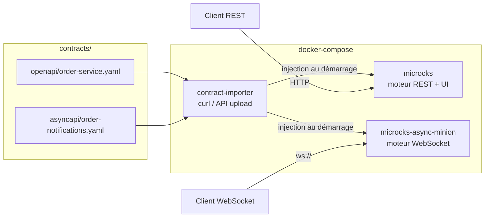

# MockMicroService

Mock de micro-service **piloté par contrat d'interface** (Swagger/OpenAPI pour le REST,
AsyncAPI pour le WebSocket), sans écrire de code métier. Le moteur de mock est
[Microcks](https://microcks.io), déployé en conteneurs Docker.

## 1. Pourquoi cette solution

| Besoin exprimé | Réponse apportée |
|---|---|
| Injecter un fichier Swagger pour générer un mock REST | Upload du fichier OpenAPI dans Microcks → endpoints REST mockés automatiquement |
| Ouvrir un canal WebSocket à partir d'un contrat | Upload d'un fichier AsyncAPI → canal WebSocket mocké automatiquement |
| Rejouer toujours le même message (REST ou WebSocket) | Utilisation de l'`example` unique défini dans chaque contrat (pas de génération aléatoire) |
| Renvoyer une erreur si le contrat n'est pas respecté | Dispatcher `JSON_BODY` déclaré dans le contrat OpenAPI (extension `x-microcks-operation`) → `400 Bad Request` si un champ requis est absent |
| Solution conteneurisée | `docker-compose.yml` avec les images officielles Microcks |
| Aucune ligne de code | Tout est piloté par les fichiers de contrat dans `contracts/` |

Le WebSocket étant en **lecture seule** dans votre cas (le client ne fait que
s'abonner, il n'envoie pas de payload métier), il n'y a rien à valider côté
serveur sur ce canal : le mock se contente de rejouer l'exemple défini dans
l'AsyncAPI à chaque connexion/abonnement.

## 2. Architecture



- **microcks** : application principale, expose l'UI (port `8585`) et les mocks REST.
  Un `healthcheck` Docker (`curl -f http://localhost:8080/api/services`) permet aux
  autres services d'attendre qu'il soit réellement prêt (l'application Spring Boot
  met quelques secondes à démarrer), et pas seulement que son conteneur ait démarré.
- **microcks-async-minion** : moteur dédié qui expose les mocks WebSocket/AsyncAPI
  (port `8586`). Dépend de `microcks: condition: service_healthy` dans
  [docker-compose.yml](docker-compose.yml) : sans cette condition, il démarre trop
  tôt, essuie un `Connection refused` vers Microcks et crashe/redémarre en boucle.
- **contract-importer** : conteneur "one-shot" (image officielle `curlimages/curl`)
  qui monte le dossier `contracts/` en **bind-mount** (lecture seule), attend que
  Microcks soit prêt puis injecte tous les contrats trouvés via l'API REST d'upload
  d'artifact (`POST /api/artifact/upload`). Comme les contrats ne sont pas embarqués
  dans une image, mocker un µService supplémentaire (ou modifier le contrat d'un
  µService existant) ne demande ni build ni modification de code : voir
  [section 6bis. Mocker plusieurs µServices](#6bis-mocker-plusieurs-%C2%B5services).
  > Le CLI officiel `microcks-cli` (≥ 1.0) exige désormais une session `login`
  > (plus de mode anonyme `--microcksURL` + `--insecure`) : on utilise donc directement
  > l'API REST, plus simple pour un import anonyme au démarrage.

## 3. Structure du projet

```
MockMicroService/
├── docker-compose.yml
├── .gitlab-ci.yml                     # pipeline d'exemple : démarrage du mock + tests d'intégration
├── contracts/
│   ├── openapi/
│   │   └── order-service.yaml        # contrat REST d'exemple
│   └── asyncapi/
│       └── order-notifications.yaml  # contrat WebSocket d'exemple
└── scripts/
    ├── inject-contract.sh            # injection manuelle a posteriori
    ├── contract-test.sh              # test de contrat Microcks, utilisé en CI
    └── upload-contracts.sh           # entrypoint du conteneur contract-importer
```

## 4. Démarrage

```bash
cd MockMicroService
docker compose up -d
```

Au démarrage, le service `contract-importer` attend que Microcks soit prêt puis
injecte automatiquement tous les contrats trouvés sous `contracts/` (deux fournis
en exemple, mais rien n'empêche d'en ajouter d'autres pour d'autres µServices).
L'UI Microcks est disponible sur `http://localhost:8585`, où vous pouvez visualiser
les APIs importées, leurs exemples et l'URL des mocks générés (menu **API & Services**).

Voir la section [5. Lancer et arrêter le mock](#5-lancer-et-arrêter-le-mock) pour
le détail des commandes de démarrage, d'arrêt et de vérification.

## 5. Lancer et arrêter le mock

### 5.1 Démarrer

```bash
docker compose up -d
```
Démarre (ou recrée) les 3 conteneurs (`microcks`, `microcks-async-minion`,
`contract-importer`) en arrière-plan. `contract-importer` se termine de lui-même
une fois les contrats injectés (c'est normal, c'est un conteneur "one-shot").

### 5.2 Vérifier l'état des conteneurs

```bash
docker compose ps
docker logs contract-importer   # doit afficher "Contrats injectés avec succès."
```

### 5.3 Suivre les logs

```bash
docker compose logs -f microcks
docker compose logs -f microcks-async-minion
```

### 5.4 Réinjecter les contrats sans tout redémarrer

Les contrats sont montés en bind-mount (pas copiés dans l'image) : après avoir
ajouté/modifié un fichier sous `contracts/`, il suffit de relancer le conteneur
`contract-importer`, sans rebuild :
```bash
docker compose up -d --force-recreate contract-importer
```

### 5.5 Arrêter le mock

```bash
docker compose down
```
Arrête et supprime les conteneurs et le réseau créés par `docker compose up`.
Les images Docker téléchargées restent en cache (pas de re-téléchargement au
prochain démarrage).

Pour repartir sur un état totalement propre (perte des éventuelles
personnalisations faites via l'UI Microcks, ex. règles de dispatching modifiées
manuellement) :
```bash
docker compose down -v
```

## 6. Étapes d'injection d'un contrat d'interface

### 6.1 Automatique (recommandé) — bind-mount, sans build

Les contrats sont montés en lecture seule depuis `contracts/` dans le conteneur
`contract-importer` (voir [docker-compose.yml](docker-compose.yml)) : aucune image
à reconstruire, aucun code à modifier.

1. Déposez votre fichier Swagger/OpenAPI dans `contracts/openapi/` (ou un sous-dossier dédié, ex. `contracts/openapi/<mon-service>/`).
2. Déposez votre fichier AsyncAPI dans `contracts/asyncapi/` (si vous avez un canal temps réel).
   `scripts/upload-contracts.sh` parcourt automatiquement tous les fichiers
   `*.yaml`/`*.yml` sous `/contracts`, quelle que soit leur arborescence.
3. Relancez l'injection :
   ```bash
   docker compose up -d --force-recreate contract-importer
   ```

Pour mocker plusieurs µServices en une fois (plusieurs contrats indépendants),
voir [section 6bis. Mocker plusieurs µServices](#6bis-mocker-plusieurs-%C2%B5services).

### 6.2 Manuelle — sur une instance déjà démarrée (sans redémarrage)

Via le script fourni :
```bash
./scripts/inject-contract.sh contracts/openapi/mon-nouveau-contrat.yaml
```

Ou directement en `curl` :
```bash
curl -X POST "http://localhost:8585/api/artifact/upload?mainArtifact=true" \
  -F "file=@contracts/openapi/order-service.yaml"
```

Ou via l'UI Microcks : **Importers → Upload artifact** puis sélectionner le fichier.

### 6.3 Pourquoi pas d'image à construire/publier

Aucune image `contract-importer` dédiée n'est construite, ni localement ni en
CI/CD : le conteneur utilise l'image officielle `curlimages/curl` telle quelle,
montée avec `contracts/` et `scripts/upload-contracts.sh` en bind-mount (section
[2. Architecture](#2-architecture)). Avantages recherchés : pas d'étape de build
dans le pipeline, pas de registre à gérer pour cette image, et un contrat ajouté/
modifié est pris en compte au prochain `docker compose up`, sans publication
intermédiaire. Si un déploiement sans accès au dépôt source est nécessaire (cas
où le bind-mount n'est pas possible), il faudra alors reconstruire une image
autonome packageant `contracts/` et le script — non couvert par ce dépôt.

### 6.4 Vérifier que le mock est bien exposé

Dans l'UI (`http://localhost:8585`), ouvrez le service importé : Microcks affiche
l'URL du mock REST, par exemple :
```
http://localhost:8585/rest/Order+Service+API/1.0.0/orders/ORD-1001
```

## 6bis. Mocker plusieurs µServices

Le bind-mount de `contracts/` (section 6.1) accepte un nombre quelconque de
contrats, organisés librement (un sous-dossier par µService, par exemple) :
```
contracts/
├── openapi/
│   ├── order-service.yaml
│   └── payment-service.yaml
└── asyncapi/
    ├── order-notifications.yaml
    └── payment-notifications.yaml
```
Pour ajouter/mettre à jour le mock d'un µService : déposez/éditez son fichier de
contrat, puis `docker compose up -d --force-recreate contract-importer`. Aucun
autre µService n'est impacté, et le contrat original de chaque µService n'a pas
besoin d'être modifié pour être mocké.

### 6bis.1 Automatiser les tests de contrat en CLI

Au-delà du mock, Microcks sait aussi **rejouer un contrat contre l'implémentation
réelle d'un µService** pour vérifier sa conformité ("contract testing"), via son
API `/api/tests`. Le script [scripts/contract-test.sh](scripts/contract-test.sh)
automatise cet appel (lancement du test + attente + code de sortie exploitable
en CI), pour n'importe quel µService déjà importé dans Microcks :

```bash
./scripts/contract-test.sh "Order Service API:1.0.0" http://order-service:8080 OPEN_API_SCHEMA 10000
./scripts/contract-test.sh "Order Notifications API:1.0.0" ws://order-service:9000/ws ASYNC_API_SCHEMA 10000
```

- `<serviceId:version>` : nom et version du service tel qu'importés dans Microcks
  (visibles dans l'UI ou dans le contrat, champs `info.title`/`info.version`).
- `<testEndpoint>` : URL réelle du µService à valider (et non celle du mock).
- `runnerType` : type de vérification (`OPEN_API_SCHEMA`, `ASYNC_API_SCHEMA`,
  `POSTMAN`, `HTTP`, `SOAP_HTTP`, `GRPC_PROTOBUF`, `GRAPHQL_SCHEMA`...).
- Le script sort en code `1` si le test échoue ou time out, ce qui permet de le
  brancher directement dans un pipeline CI (voir [section 9](#9-int%C3%A9gration-continue-gitlab-ci))
  pour valider automatiquement, à chaque déploiement, que chaque µService
  respecte toujours son contrat — sans jamais avoir à modifier ce contrat.

## 7. Exemples d'utilisation

### 7.1 Mock REST — requête conforme au contrat

```bash
curl http://localhost:8585/rest/Order+Service+API/1.0.0/orders/ORD-1001
```
Réponse (toujours le même exemple défini dans le Swagger) :
```json
{
  "id": "ORD-1001",
  "status": "CONFIRMED",
  "amount": 129.90,
  "customerId": "CUST-42"
}
```

### 7.2 Mock REST — création avec un corps valide

```bash
curl -X POST http://localhost:8585/rest/Order+Service+API/1.0.0/orders \
  -H "Content-Type: application/json" \
  -d '{"customerId":"CUST-42","amount":129.90}'
```

### 7.3 Mock REST — requête non conforme au contrat → 400

```bash
curl -i -X POST http://localhost:8585/rest/Order+Service+API/1.0.0/orders \
  -H "Content-Type: application/json" \
  -d '{"amount":"pas-un-nombre"}'
```
Le contrat OpenAPI déclare un dispatcher `JSON_BODY` (extension
`x-microcks-operation`) qui vérifie la présence du champ `customerId` : absent,
la requête est routée vers l'exemple de réponse `invalid` → `400 Bad Request`.
Microcks (édition communautaire) ne valide pas automatiquement le schéma JSON
complet sur un simple appel de mock ; c'est ce dispatcher déclaratif qui reproduit
ce comportement sans écrire de code.

### 7.4 Mock WebSocket — abonnement en lecture seule

```bash
# avec wscat (npm install -g wscat) ou websocat (https://github.com/vi/websocat)
wscat -c ws://localhost:8586/api/ws/Order+Notifications+API/1.0.0/orders/notifications
```
Le mock pousse alors en boucle le même message défini dans l'exemple AsyncAPI :
```json
{
  "id": "ORD-1001",
  "status": "CONFIRMED",
  "amount": 129.90,
  "customerId": "CUST-42"
}
```

> ⚠️ `wscat` se ferme immédiatement sans rien recevoir si son entrée standard
> n'est pas un terminal interactif (systématiquement le cas dans un script ou
> un job CI) : il fonctionne bien en usage manuel comme ci-dessus, mais pas dans
> un pipeline automatisé. Pour un test scripté/non-interactif, utilisez plutôt
> [scripts/contract-test.sh](scripts/contract-test.sh) (voir [section 9. Intégration continue (GitLab CI)](#9-int%C3%A9gration-continue-gitlab-ci)).

> Le chemin exact de l'endpoint WebSocket (`/api/ws/...`) est indiqué dans l'UI
> Microcks, onglet de l'API AsyncAPI importée, section "Mock URL". Le contrat
> AsyncAPI doit déclarer explicitement un binding `ws` sur le channel (voir
> `contracts/asyncapi/order-notifications.yaml`), sinon Microcks le traite par
> défaut comme un topic Kafka et le mock WebSocket répond "No mock available".

## 8. Ajouter votre propre contrat de production

1. Copiez votre fichier Swagger existant dans `contracts/openapi/`.
2. Assurez-vous qu'il contient bien des `examples` pour chaque réponse **et** pour
   chaque paramètre de chemin (le nom de l'exemple du paramètre doit correspondre
   au nom de l'exemple de la réponse, ex. `ORD-1001`), sinon Microcks ne peut pas
   dispatcher le mock correctement.
3. Injectez-le (section 6.1 ou 6.2).
4. Si vous avez aussi besoin d'un canal WebSocket, écrivez un fichier AsyncAPI
   minimal sur le modèle de `contracts/asyncapi/order-notifications.yaml` (avec
   un binding `ws` explicite sur le channel) et injectez-le de la même façon.

## 9. Intégration continue (GitLab CI)

[.gitlab-ci.yml](.gitlab-ci.yml) fournit un exemple de job d'intégration qui
démarre le mock complet (Microcks + async-minion + contract-importer, sans
aucun build d'image), attend l'injection des contrats, lance un test de contrat
Microcks (via [scripts/contract-test.sh](scripts/contract-test.sh)) sur chacun
des deux canaux (REST et WebSocket), puis arrête et nettoie la stack.

### 9.1 Prérequis runner

Le job utilise un service `docker:26.1-dind` (Docker-in-Docker) pour lancer
`docker-compose` depuis le job : le runner GitLab doit utiliser l'executor
`docker` en mode **privilégié** (`privileged = true` dans `config.toml`), sinon
le service dind ne démarre pas. Voir les commentaires en tête du fichier pour
le détail et l'alternative sans dind (montage du socket Docker de l'hôte).

### 9.2 Points de synchronisation importants

Deux races conditions ont été identifiées et corrigées lors de la mise au point
de ce pipeline — à connaître si vous l'adaptez à un autre contexte :

- **Attendre la fin de l'injection, pas seulement la dispo de Microcks** :
  `curl http://microcks:8080/api/services` répond dès le démarrage de Microcks,
  avant même que `contract-importer` ait fini d'injecter les contrats. Le job
  utilise donc `docker wait contract-importer` (bloquant jusqu'à la fin du
  conteneur one-shot) et vérifie son code de sortie, plutôt qu'un simple ping.
- **`microcks-async-minion` démarre trop vite** : sans coordination, il tente de
  joindre Microcks avant que ce dernier soit prêt (`Connection refused`), crashe
  et redémarre. Le `healthcheck` de `microcks` et le `depends_on: condition:
  service_healthy` dans [docker-compose.yml](docker-compose.yml) évitent ce
  crash-boucle.

### 9.3 Adapter le pipeline

Ce fichier est un exemple à copier/adapter dans le pipeline du micro-service
consommateur du mock (ex. pour valider un client REST/WebSocket contre les
contrats avant de le déployer). Les appels à `scripts/contract-test.sh` peuvent
être dupliqués/paramétrés pour couvrir d'autres services/contrats (voir
[section 6bis. Mocker plusieurs µServices](#6bis-mocker-plusieurs-%C2%B5services)),
tant que le mock est démarré/arrêté de la même façon.

## 10. Aller plus loin

- Documentation Microcks : https://microcks.io/documentation/
- Format des exemples OpenAPI : https://microcks.io/documentation/references/artifacts/openapi-conventions/
- Format des exemples AsyncAPI : https://microcks.io/documentation/references/artifacts/asyncapi-conventions/
