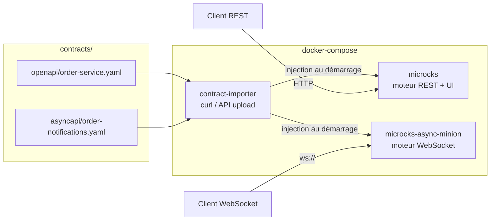

# MockMicroService

Mock de micro-service **piloté par contrat d'interface** (Swagger/OpenAPI pour le REST,
AsyncAPI pour le WebSocket), sans écrire de code métier. Le moteur de mock est
[Microcks](https://microcks.io), déployé en conteneurs Docker.

## 1. Pourquoi cette solution

| Besoin exprimé | Réponse apportée |
|---|---|
| Injecter un fichier Swagger pour générer un mock REST | Upload du fichier OpenAPI dans Microcks → endpoints REST mockés automatiquement |
| Ouvrir un canal WebSocket à partir d'un contrat | Upload d'un fichier AsyncAPI → canal WebSocket mocké automatiquement |
| Rejouer toujours le même message (REST ou WebSocket) | Utilisation de l'`example` unique défini dans chaque contrat (pas de génération aléatoire) |
| Renvoyer une erreur si le contrat n'est pas respecté | Dispatcher `JSON_BODY` déclaré dans le contrat OpenAPI (extension `x-microcks-operation`) → `400 Bad Request` si un champ requis est absent |
| Solution conteneurisée | `docker-compose.yml` avec les images officielles Microcks |
| Aucune ligne de code | Tout est piloté par les fichiers de contrat dans `contracts/` |

Le WebSocket étant en **lecture seule** dans votre cas (le client ne fait que
s'abonner, il n'envoie pas de payload métier), il n'y a rien à valider côté
serveur sur ce canal : le mock se contente de rejouer l'exemple défini dans
l'AsyncAPI à chaque connexion/abonnement.

## 2. Architecture



- **microcks** : application principale, expose l'UI (port `8585`) et les mocks REST.
- **microcks-async-minion** : moteur dédié qui expose les mocks WebSocket/AsyncAPI (port `8586`).
- **contract-importer** : conteneur "one-shot" issu d'une image **"maison"** (voir
  [Dockerfile.contract-importer](Dockerfile.contract-importer)) qui embarque les
  contrats du dossier `contracts/` au moment du build, attend que Microcks soit
  prêt puis les injecte via l'API REST d'upload d'artifact
  (`POST /api/artifact/upload`), sans action manuelle ni bind-mount.
  > Le CLI officiel `microcks-cli` (≥ 1.0) exige désormais une session `login`
  > (plus de mode anonyme `--microcksURL` + `--insecure`) : on utilise donc directement
  > l'API REST, plus simple pour un import anonyme au démarrage.

## 3. Structure du projet

```
MockMicroService/
├── docker-compose.yml
├── Dockerfile.contract-importer       # image "maison" du contract-importer
├── contracts/
│   ├── openapi/
│   │   └── order-service.yaml        # contrat REST d'exemple
│   └── asyncapi/
│       └── order-notifications.yaml  # contrat WebSocket d'exemple
└── scripts/
    ├── inject-contract.sh            # injection manuelle a posteriori
    └── upload-contracts.sh           # entrypoint embarqué dans l'image "maison"
```

## 4. Démarrage

```bash
cd MockMicroService
docker compose up -d
```

Au démarrage, le service `contract-importer` attend que Microcks soit prêt puis
injecte automatiquement les deux contrats fournis dans `contracts/`. L'UI Microcks
est disponible sur `http://localhost:8585`, où vous pouvez visualiser les APIs
importées, leurs exemples et l'URL des mocks générés (menu **API & Services**).

Voir la section [5. Lancer et arrêter le mock](#5-lancer-et-arrêter-le-mock) pour
le détail des commandes de démarrage, d'arrêt et de vérification.

## 5. Lancer et arrêter le mock

### 5.1 Démarrer

```bash
docker compose up -d
```
Démarre (ou recrée) les 3 conteneurs (`microcks`, `microcks-async-minion`,
`contract-importer`) en arrière-plan. La première fois (ou après une modification
de `contracts/`), l'image "maison" `contract-importer` est (re)construite
automatiquement à partir de [Dockerfile.contract-importer](Dockerfile.contract-importer).
`contract-importer` se termine de lui-même une fois les contrats injectés
(c'est normal, c'est un conteneur "one-shot").

### 5.2 Vérifier l'état des conteneurs

```bash
docker compose ps
docker logs contract-importer   # doit afficher "Contrats injectés avec succès."
```

### 5.3 Suivre les logs

```bash
docker compose logs -f microcks
docker compose logs -f microcks-async-minion
```

### 5.4 Réinjecter les contrats sans tout redémarrer

Après avoir modifié un fichier sous `contracts/`, l'image doit être reconstruite
(les contrats sont copiés dans l'image au build, pas montés en volume) :
```bash
docker compose build contract-importer
docker compose up -d --force-recreate contract-importer
```

### 5.5 Arrêter le mock

```bash
docker compose down
```
Arrête et supprime les conteneurs et le réseau créés par `docker compose up`.
Les images Docker téléchargées restent en cache (pas de re-téléchargement au
prochain démarrage).

Pour repartir sur un état totalement propre (perte des éventuelles
personnalisations faites via l'UI Microcks, ex. règles de dispatching modifiées
manuellement) :
```bash
docker compose down -v
```

## 6. Étapes d'injection d'un contrat d'interface

### 6.1 Automatique (recommandé) — image "maison" du contract-importer

Les contrats sont embarqués **au moment du build** de l'image `contract-importer`
(voir [Dockerfile.contract-importer](Dockerfile.contract-importer)), ce qui la
rend autonome (déployable sans bind-mount, versionnable, poussable sur un registre).

1. Déposez votre fichier Swagger/OpenAPI dans `contracts/openapi/`.
2. Déposez votre fichier AsyncAPI dans `contracts/asyncapi/` (si vous avez un canal temps réel).
   `scripts/upload-contracts.sh` parcourt automatiquement tous les fichiers
   `*.yaml`/`*.yml` sous `/contracts` : aucune modification du Dockerfile n'est nécessaire.
3. Reconstruisez l'image et relancez l'injection :
   ```bash
   docker compose build contract-importer
   docker compose up -d --force-recreate contract-importer
   ```

Pour distribuer cette image "maison" sur un registre Docker : voir
[section 6.3 Publier l'image sur JFrog Artifactory](#63-publier-limage-sur-jfrog-artifactory).

### 6.2 Manuelle — sur une instance déjà démarrée (sans redémarrage)

Via le script fourni :
```bash
./scripts/inject-contract.sh contracts/openapi/mon-nouveau-contrat.yaml
```

Ou directement en `curl` :
```bash
curl -X POST "http://localhost:8585/api/artifact/upload?mainArtifact=true" \
  -F "file=@contracts/openapi/order-service.yaml"
```

Ou via l'UI Microcks : **Importers → Upload artifact** puis sélectionner le fichier.

### 6.3 Publier l'image sur JFrog Artifactory

L'image `contract-importer` est **autosuffisante** : elle embarque les contrats et
le script d'injection, et n'a besoin que d'un accès réseau vers Microcks au
démarrage. Elle peut donc être construite une fois en CI/CD, poussée sur un
registre Docker JFrog Artifactory, puis réutilisée telle quelle (sans code source
ni bind-mount) dans n'importe quel environnement.

1. Authentifiez-vous auprès de votre registre Docker Artifactory (identifiants/
   jeton d'accès générés dans Artifactory, menu **Edit Profile → Generate an
   Identity Token**) :
   ```bash
   docker login mon-instance.jfrog.io
   ```
2. Construisez l'image en la taguant avec le chemin complet du repository Docker
   Artifactory (`<registre>/<repo-docker>/<image>:<tag>`) :
   ```bash
   docker build -f Dockerfile.contract-importer \
     --build-arg IMAGE_VERSION=1.0.0 \
     -t mon-instance.jfrog.io/mon-repo-docker/contract-importer:1.0.0 \
     -t mon-instance.jfrog.io/mon-repo-docker/contract-importer:latest \
     .
   ```
3. Poussez l'image :
   ```bash
   docker push mon-instance.jfrog.io/mon-repo-docker/contract-importer:1.0.0
   docker push mon-instance.jfrog.io/mon-repo-docker/contract-importer:latest
   ```
4. Pour la réutiliser ailleurs (autre machine, CI, cluster), il suffit de la
   référencer directement dans `docker-compose.yml` (plus besoin de `build:`) :
   ```yaml
   contract-importer:
     image: mon-instance.jfrog.io/mon-repo-docker/contract-importer:1.0.0
     environment:
       - MICROCKS_URL=http://microcks:8080   # adapter selon l'environnement cible
     depends_on:
       - microcks
       - microcks-async-minion
     restart: "no"
   ```
   ```bash
   docker pull mon-instance.jfrog.io/mon-repo-docker/contract-importer:1.0.0
   docker compose up -d
   ```

> `MICROCKS_URL` est défini avec une valeur par défaut (`http://microcks:8080`)
> dans l'image, mais reste surchargeable au `docker run`/`docker compose` via une
> variable d'environnement, sans avoir à reconstruire l'image.

### 6.4 Vérifier que le mock est bien exposé

Dans l'UI (`http://localhost:8585`), ouvrez le service importé : Microcks affiche
l'URL du mock REST, par exemple :
```
http://localhost:8585/rest/Order+Service+API/1.0.0/orders/ORD-1001
```

## 7. Exemples d'utilisation

### 7.1 Mock REST — requête conforme au contrat

```bash
curl http://localhost:8585/rest/Order+Service+API/1.0.0/orders/ORD-1001
```
Réponse (toujours le même exemple défini dans le Swagger) :
```json
{
  "id": "ORD-1001",
  "status": "CONFIRMED",
  "amount": 129.90,
  "customerId": "CUST-42"
}
```

### 7.2 Mock REST — création avec un corps valide

```bash
curl -X POST http://localhost:8585/rest/Order+Service+API/1.0.0/orders \
  -H "Content-Type: application/json" \
  -d '{"customerId":"CUST-42","amount":129.90}'
```

### 7.3 Mock REST — requête non conforme au contrat → 400

```bash
curl -i -X POST http://localhost:8585/rest/Order+Service+API/1.0.0/orders \
  -H "Content-Type: application/json" \
  -d '{"amount":"pas-un-nombre"}'
```
Le contrat OpenAPI déclare un dispatcher `JSON_BODY` (extension
`x-microcks-operation`) qui vérifie la présence du champ `customerId` : absent,
la requête est routée vers l'exemple de réponse `invalid` → `400 Bad Request`.
Microcks (édition communautaire) ne valide pas automatiquement le schéma JSON
complet sur un simple appel de mock ; c'est ce dispatcher déclaratif qui reproduit
ce comportement sans écrire de code.

### 7.4 Mock WebSocket — abonnement en lecture seule

```bash
# avec wscat (npm install -g wscat) ou websocat (https://github.com/vi/websocat)
wscat -c ws://localhost:8586/api/ws/Order+Notifications+API/1.0.0/orders/notifications
```
Le mock pousse alors en boucle le même message défini dans l'exemple AsyncAPI :
```json
{
  "id": "ORD-1001",
  "status": "CONFIRMED",
  "amount": 129.90,
  "customerId": "CUST-42"
}
```

> Le chemin exact de l'endpoint WebSocket (`/api/ws/...`) est indiqué dans l'UI
> Microcks, onglet de l'API AsyncAPI importée, section "Mock URL". Le contrat
> AsyncAPI doit déclarer explicitement un binding `ws` sur le channel (voir
> `contracts/asyncapi/order-notifications.yaml`), sinon Microcks le traite par
> défaut comme un topic Kafka et le mock WebSocket répond "No mock available".

## 8. Ajouter votre propre contrat de production

1. Copiez votre fichier Swagger existant dans `contracts/openapi/`.
2. Assurez-vous qu'il contient bien des `examples` pour chaque réponse **et** pour
   chaque paramètre de chemin (le nom de l'exemple du paramètre doit correspondre
   au nom de l'exemple de la réponse, ex. `ORD-1001`), sinon Microcks ne peut pas
   dispatcher le mock correctement.
3. Injectez-le (section 6.1 ou 6.2).
4. Si vous avez aussi besoin d'un canal WebSocket, écrivez un fichier AsyncAPI
   minimal sur le modèle de `contracts/asyncapi/order-notifications.yaml` (avec
   un binding `ws` explicite sur le channel) et injectez-le de la même façon.

## 9. Aller plus loin

- Documentation Microcks : https://microcks.io/documentation/
- Format des exemples OpenAPI : https://microcks.io/documentation/references/artifacts/openapi-conventions/
- Format des exemples AsyncAPI : https://microcks.io/documentation/references/artifacts/asyncapi-conventions/
